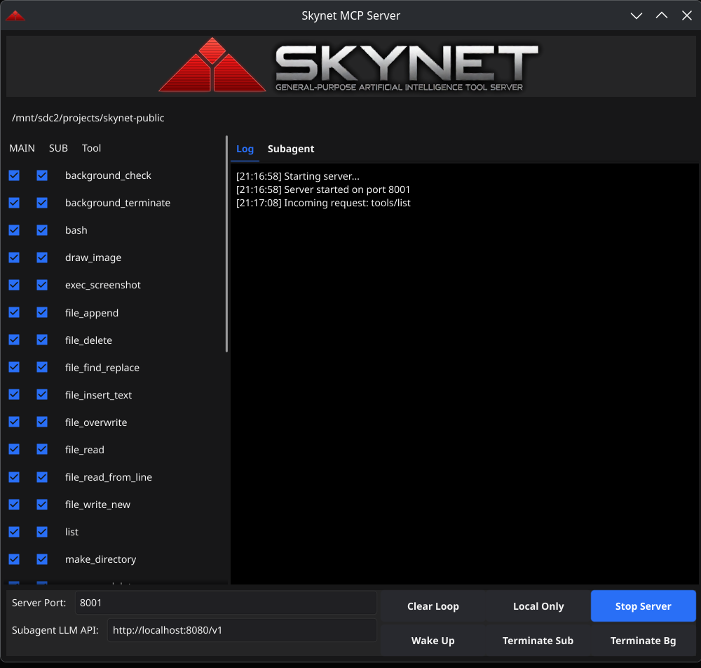

# Skynet

A Model Context Protocol (MCP) server that provides tools for file system operations, shell command execution, memory management, web search, and subagent orchestration.


## Features

- HTTP-based MCP protocol server (default port 8001)
- **Interactive GUI** (Fyne) for tool configuration and server monitoring
- **Cross-platform**: Linux and Windows officially supported, Mac may or may not work
- **Configurable port** via GUI interface
- **Remote access control** - by default only localhost connections allowed
- Built-in loop detection to prevent repeated tool calls
- CORS support for web-based clients
- Extensible tool registry architecture
- Undo/rollback for file editing tools
- **Dynamic prompts support** - load and retrieve reusable prompt templates
- **Memory system** - persistent key-value storage with hash-based addressing
- **Autonomous subagents** - the main LLM can delegate multi-step tasks to subagents that run their own tool-calling loop against a local LLM server
- Path security validation
- **Web Search** - powered by Exa for current information and webpage fetching
- Made in itself - tested in real production environment

## GUI Configuration

When you start the server, an interactive Fyne GUI will appear with the following layout:

### Main Window
- **Left panel**: List of available tools, each with two checkboxes: **MAIN** (available to the main LLM) and **SUB** (available to subagents)
- **Right panel**: Scrolling log window displaying real-time server events, including server startup/shutdown, incoming MCP requests, tool execution results, loop detection triggers, errors and warnings
- **Bottom bar**:
  - **Port field**: Enter the server port number (1-65535). The current port is displayed and can be edited directly
  - **Remote Access button**: Toggles between "Local Only" (default, localhost connections only) and "Remote Access" (allows connections from any IP). ⚠️ Enabling remote access is a security risk!
  - **Clear Loop History button**: Clears the loop detection history
  - **Start/Stop button**: Starts or stops the HTTP server

### Behavior
- The server starts automatically when the GUI opens
- Tool enable/disable settings and port configuration are saved automatically to `.skynet.yml` when the window is closed
- The log window updates in real-time



## Available Tools

| Tool | Description | Parameters |
|------|-------------|------------|
| `bash` | Execute a bash command and return the output (Unix/Linux/macOS). If the command exceeds the time limit, it continues in the background | `command` (required): The bash command to execute |
| `file_read` | Read contents of a file. | `path` (required): File path relative to current directory |
| `file_read_from_line` | Read specific lines from a file starting at a given line number. | `path` (required), `start_line` (required), `num_lines` (optional, default: 50), `show_line_numbers` (required, boolean): Whether to include line numbers |
| `file_write_new` | Write content to a new file. Fails if the file already exists. | `path` (required), `content` (required) |
| `file_overwrite` | Overwrite an existing file with new content. Creates the file if it doesn't exist. | `path` (required), `content` (required) |
| `file_append` | Append text to the end of a file | `path` (required), `text` (required), `add_newlines` (required, boolean) |
| `file_delete` | Delete a file | `path` (required): File path relative to current directory |
| `list` | List files and directories. | `path` (optional, default: "."), `recursive` (optional, default: false), `max_entries` (optional, default: 100), `show_hidden` (optional, default: false) |
| `ripgrep` | Search file contents using ripgrep (rg). Requires ripgrep to be installed (an install hint for the current platform is returned if missing). | `pattern` (required), `path` (optional, default: "."), `glob` (optional), `case_sensitive` (optional, default: false), `max_depth` (optional), `count` (optional, default: false), `hidden` (optional, default: false), `text` (optional, default: false), `context_before` (optional, default: 0), `context_after` (optional, default: 0), `max_results` (optional), `type` (optional), `word_match` (optional, default: false), `regex` (required, no default): pattern is regex (true) or plain text (false) |
| `file_find_replace` | Find and replace specific text in a file with another string | `path` (required), `find` (required): The exact text to search for, `replace_with` (required): The text to replace with, `replace_all` (required, boolean): Replace all occurrences |
| `file_insert_text` | Inserts text before or after a specific string anchor | `path` (required), `anchor_text` (required), `text_to_insert` (required), `insert_before` (required, boolean), `insert_all` (required, boolean), `add_newlines` (required, boolean) |
| `rollback` | Restore a file to its state before an edit, using a rollback entry hash | `hash` (required): Hash of the rollback entry |
| `make_directory` | Create a new directory | `path` (required): Directory path to create, `parents` (optional, default: false): Create parent directories if needed (like mkdir -p) |
| `powershell` | Execute a PowerShell command and return the output (cross-platform; uses `powershell` on Windows, `pwsh` on Linux/macOS). If the command exceeds the time limit, it continues in the background | `command` (required): The PowerShell command to execute || `background_check` | Check the status and captured output of a background process | `id` (required): The background process id |
| `background_terminate` | Terminate a background process and its child processes | `id` (required): The background process id |
| `sleep` | Wait a specified number of seconds (1-600). Returns early if the user presses Wake Up | `seconds` (required): Number of seconds to sleep (1-600) |

| `view_image` | Read an image file and return base64-encoded data for VLM input | `path` (required): Image file path relative to current directory |
| `draw_image` | Draw image as a PNG file. Takes raw SVG markup as input and saves it as base64-encoded PNG | `svg` (required): Raw SVG markup, `output_file` (required): Relative path to save the PNG image |
| `exec_screenshot` | Execute an executable from the working directory and take a screenshot of the spawned window after a delay | `executable` (required): Path to executable relative to working directory, `delay` (optional, default: 5): Delay before screenshot in seconds |
| `web_search_exa` | Search the web for any topic and get clean, ready-to-use content | `query` (required), `numResults` (optional, default: 10) |
| `web_fetch_exa` | Read a webpage's full content as clean markdown | `urls` (required), `maxCharacters` (optional, default: 3000) |

### VLM (Vision-Language Model) Support

Skynet provides two tools for VLM-compatible image input:

#### `view_image` - Read Existing Images
Reads image files and returns them in MCP's standard image resource format.

**Supported Formats**: JPEG, PNG, GIF, WebP, BMP, TIFF, ICO, SVG

**MCP Response Format**:
```json
{
  "content": [
    {
      "type": "image",
      "data": "iVBORw0KGgoAAAANSUhEUg...",
      "mimeType": "image/png"
    }
  ]
}
```

**Usage**:
- Returns base64-encoded image data with proper MIME type
- Compatible with VLM API calls through MCP
- Maximum image size: 50MB

**SVG Support**:
- SVG files are automatically rasterized to PNG using `rsvg-convert`
- **Requires `rsvg-convert` to be installed** (package: `librsvg2-bin` on Debian/Ubuntu)
- Install with: `sudo apt-get install -y librsvg2-bin`
- If `rsvg-convert` is not available, SVG tool calls will return an error

**Resolution Limiting**:
- Images larger than 1024×1024 pixels are automatically downscaled to fit within the limit while preserving aspect ratio
- Uses high-quality CatmullRom interpolation for clean resampling
- Downscaling is applied transparently (no need to request it)
- Smaller images pass through unchanged

#### `draw_image` - Render SVG Code
Renders raw SVG markup to a raster PNG image.

**Parameters**:
- `svg` (required): Raw SVG markup code as a string
- `output_file` (required): Relative path to save the converted PNG image

**Requirements**:
- **Requires `rsvg-convert` to be installed** (package: `librsvg2-bin` on Debian/Ubuntu)
- Install with: `sudo apt-get install -y librsvg2-bin`

**Resolution Limiting**:
- Output images larger than 1024×1024 pixels are automatically downscaled to fit within the limit while preserving aspect ratio
- Uses high-quality CatmullRom interpolation for clean resampling
- Downscaling is applied transparently after rasterization

**Usage**:
- Takes SVG markup as input (strings, not file paths)
- Rasterizes the SVG via `rsvg-convert` (piped over stdin, no temporary file)
- Saves the converted bitmap to the PNG file specified by `output_file`
- Returns base64-encoded PNG in the same format as `view_image`
- Maximum output size: 50MB

**Example SVG Input**:
```xml
<svg xmlns="http://www.w3.org/2000/svg" width="200" height="200">
  <circle cx="100" cy="100" r="80" fill="steelblue"/>
</svg>
```

**Example Tool Call**:
```json
{
  "name": "draw_image",
  "arguments": {
    "svg": "<svg xmlns='http://www.w3.org/2000/svg' width='200' height='200'><circle cx='100' cy='100' r='80' fill='steelblue'/></svg>",
    "output_file": "output/circle.png"
  }
}
```

**Use Cases**:
- Generate diagrams programmatically (flowcharts, charts, etc.)
- Render code visualizations
- Create custom icons or logos
- Test SVG rendering without creating files on disk

## Memory System

The server includes a simple memory system for persistent key-value storage. Memories are stored as `.txt` files in a `.memory/` directory.

### How It Works

- Each memory is stored as a `.txt` file in the `.memory/` directory
- The filename is derived from a sanitized version of the description and the memory hash
- The first line of the file is the description
- A hash ID (first 10 characters of MD5 hash of the description) is used to uniquely identify memories
- Memories can be added, read, edited, and deleted using the memory tools

### Using Memories

1. **Add a memory**: Use `memory_write_new` with a description
2. **List memories**: Use `memory_list` to see all memories and their hash IDs
3. **Read a memory**: Use `memory_read` with the hash ID
4. **Edit a memory**: Use `memory_edit` with the hash ID, search text, and replacement
5. **Overwrite a memory**: Use `memory_overwrite` to completely replace the content or update the identity
6. **Delete a memory**: Use `memory_delete` with the hash ID

### Example Workflow

```
1. Add a memory:
   memory_write_new(description="Important project details", content="Full notes here...")

2. List memories:
   memory_list()
   → Returns list with hash IDs like "98dea45829"

3. Read the memory:
   memory_read(hash="98dea45829")

4. Edit the memory:
   memory_edit(hash="98dea45829", search_text="old text", replacement="new text")

5. Overwrite the memory:
   memory_overwrite(hash="98dea45829", content="Completely new content")

6. Delete the memory:
   memory_delete(hash="98dea45829")
```

## Prompts

The server supports dynamic prompts that can be loaded from text files. Prompts are stored as `.txt` files in a `.prompts/` directory and are scanned dynamically on each request.

### Creating Prompts

Create a `.txt` or `.md` file in the `.prompts/` directory. The filename (without extension) becomes the prompt name.

```
.prompts/
├── code_review.txt
└── summarize.md
```

## Rollback

Skynet provides undo support for its file editing tools. Whenever a file is modified by one of the mutating tools (`file_write_new`, `file_overwrite`, `file_append`, `file_find_replace`, `file_insert_text`, `file_delete`), the file's **pre-mutation state** is automatically saved as a rollback entry, and the tool's response includes a `rollback` hash identifying it.

- **Storage**: entries are stored as files in a hidden `.rollback/` directory. The entry filename is the MD5 hash of the file's relative path plus its content, so identical states deduplicate to the same entry.
- **Restoring**: the `rollback` tool takes a `hash` and restores the file to the state captured by that entry.
- **Chaining**: restoring is itself reversible. If the file currently exists when you roll back, its current state is saved as a *new* rollback entry first, and the response returns that chained hash — so you can always roll back the rollback.
- **Unavailable cases**: no entry is created (and the response reports `"rollback": "unavailable"`) when a file exceeds the 100MB size limit, the file did not exist (`"absent"`), or a read/write failed.

## Subagents

Skynet can delegate tasks to **autonomous subagents**. The main LLM spawns a subagent via the `subagent_start` tool; the subagent then runs its own loop against a local LLM server — thinking, calling tools (any tools enabled with the **SUB** checkbox), reading results — until it answers directly.

### Subagent Tools

| Tool | Description | Parameters |
|------|-------------|------------|
| `subagent_start` | Spawns a new subagent run and returns its response and a `hash` to continue the run | `system_prompt` (required), `prompt` (required), `tools` (optional, default none — empty list runs the subagent without tools), `thinking` (required, no default): enable model-side reasoning, `halt_on_narration` (required, no default): see below |
| `subagent_resume` | Continues an existing run **exactly where it left off** (no new prompt needed) | `hash` (required) |
| `subagent_reprompt` | Continues an existing run with a **new user question**, preserving the full conversation | `hash` (required), `prompt` (required) |
| `subagent_inspect` | Read-only observability: lists the run's turns so far (`think` / `content` / `tool` / `tool return`) with short previews (last 50 turns, 120-char previews) | `hash` (required) |
| `subagent_inspect_turn` | Returns the full content of one turn by its index (as listed by `subagent_inspect`) | `hash` (required), `index` (required) |

### How Subagent Runs Work

- **Termination**: with `halt_on_narration: true`, any step that produces answer content ends the run immediately — even if tool calls were also requested in that step. With `halt_on_narration: false`, the subagent keeps going through content-plus-tool-call steps; only a content step without tool calls ends the run. Choose `false` when you want the subagent to complete a multi-step task in a single run.
- **Run stats**: every returned response ends with `Context: X of Y tokens used (Z remaining)` (the last LLM request's usage from the stream's `usage` field, falling back to the `/tokenize` endpoint, against the server's live `n_ctx`) and `Duration: <wall-clock time>` of the run.
- **Pending calls**: if a terminating step requested tool calls that were not executed, they are saved with the run. `subagent_resume` executes them first, feeds the results back to the model, and continues the loop — so resume picks up exactly where the run stopped.
- **History**: the full conversation (system prompt, prompts, assistant turns, tool results) is persisted per run and reused by resume/reprompt, so the subagent remembers everything it did before. Previous thinking turns are preserved in the conversation and re-sent on resume.
- **Reasoning budget**: when `thinking` is enabled, the model's reasoning (thinking) is capped at 4096 tokens per LLM request (`thinking_budget_tokens`), with a "Reasoning budget exceeded" message sent when it is exhausted.
- **Limits**: up to 100 LLM round-trips per run, a 60-minute total deadline, and a 10-minute per-request timeout.
- **Loop detection**: subagents get the same protection as the main agent — the first repetition of an identical tool call with an identical result is replaced with a warning so the subagent can break out of the loop; only if it keeps repeating is the run terminated.
- **Interrupted runs**: a run stopped by user termination, the total deadline, max iterations, or loop detection ends without a final answer, but the response still contains the run's `hash` (plus any partial content), so you can continue it with `subagent_resume`.
- **Concurrency**: at most one subagent run is active at a time.
- **Observability**: while a run is in flight the main LLM is blind to it, except for the GUI's Subagent tab. `subagent_inspect` / `subagent_inspect_turn` give it read-only access to the run's full turn history (derived from the persisted conversation, so it also works on completed and interrupted runs).

### Configuration

- **LLM endpoint**: subagents talk to an OpenAI-compatible server (designed for a local `llama.cpp` server, e.g. `http://localhost:8080/v1`). Set the endpoint via the GUI's **Subagent LLM API** field or the `subagent_llm_api` setting in `.skynet.yml`.
- **Tool access**: subagents can only use tools that have the **SUB** checkbox enabled. Tools in the default-disabled list (`default_disabled.go` — the subagent tools) start unchecked unless explicitly enabled in `.skynet.yml`. The **MAIN** state defaults to enabled for all tools.
- **Monitoring**: all subagent activity (thinking, assistant output, tool calls, tool results) is streamed live to the GUI's **Subagent** tab.

## Building

```bash
./build.sh
```

## Running

```bash
./skynet
```

The server will display a GUI configuration screen and start automatically.

## API Endpoints

### POST /mcp

Accepts JSON-RPC 2.0 formatted requests.

## Configuration

- **Port**: Configurable via GUI (default: 8001)
- **Tools**: Selective enable/disable via GUI
- **Remote Access**: Disabled by default (localhost only). Enable in GUI if needed.

### Persistent Settings

The server automatically saves and loads your configuration settings to a hidden `.skynet.yml` file in the working directory.

#### What Gets Saved
- **Enabled/Disabled tools**: Your tool selections (main and subagent) are remembered
- **Port number**: Your custom port configuration persists
- **Remote access setting**: Your remote access choice is remembered
- **Subagent LLM API endpoint**: Your subagent LLM server URL persists

#### How It Works
- **On startup**: Settings are loaded from `.skynet.yml` (if it exists). If the file doesn't exist or is invalid, default settings are used.
- **On exit**: When you quit the GUI, your current settings are automatically saved to `.skynet.yml`.

#### Example `.skynet.yml` File
```yaml
enabled_tools:
  bash: true
  file_read: true
  file_write_new: false
subagent_enabled_tools:
  bash: true
  file_read: true
port: 8001
remote_access: false
subagent_llm_api: http://localhost:8080/v1
```

#### Manual Override
You can also manually edit the `.skynet.yml` file to configure settings, or delete it to reset to defaults.

## Security

### Default Security Settings

By default, the server is configured with the following security measures:

- **Localhost Only**: Only accepts connections from `127.0.0.1` or `localhost`
- **No Remote Access**: Remote connections are blocked by default
- **Tool Control**: All tools can be individually enabled/disabled

### Remote Access Warning

**Enabling remote access is a security risk!** When enabled:
- Any machine on your network can connect
- Attackers could execute arbitrary bash commands
- Sensitive files could be read/written
- Your system could be compromised

### Recommended Security Practices

1. **Keep remote access disabled** unless absolutely necessary
2. **Use firewall rules** to restrict access even when remote access is enabled
3. **Run behind authentication** (reverse proxy with auth)
4. **Use non-default ports** to avoid automated scans
5. **Monitor server logs** for suspicious activity
6. **Limit tool access** - disable tools you don't need
7. **Run in a container** or isolated environment

## Loop Detection

The server includes automatic loop detection that prevents repeated tool calls with the same arguments, helping to avoid infinite loops in automated workflows.

### Production Notes

Skynet was made using a combination of hand-written code and code produced by ~20b class local LLMs (Qwen 3.8, Gemma 4, Muse Glimmer). It's optimized for use by local agents and features workarounds for their most common failure modes. Cloud models haven't been used in its develompment or testing at any point, and its performance with these models is unknown.

## Dependencies

- Go 1.27+
- fyne.io/fyne/v2 (GUI framework)
- gopkg.in/yaml.v3 (settings persistence)
- golang.org/x/image (image processing)

### Optional Dependencies

Some tools shell out to external binaries that must be installed separately. They are not required to build or run the server — the corresponding tools simply return an install hint (or error) if the binary is missing.

| Binary | Required by | Install (Debian/Ubuntu) | Install (other platforms) |
|--------|-------------|--------------------------|---------------------------|
| `rg` (ripgrep) | `ripgrep` | `sudo apt install ripgrep` | `brew install ripgrep` (macOS), `winget install BurntSushi.ripgrep` / `scoop install ripgrep` / `choco install ripgrep` (Windows) |
| `rsvg-convert` | `view_image`, `draw_image` (SVG rasterization) | `sudo apt install librsvg2-bin` | `brew install librsvg` (macOS); not available natively on Windows |
| `pwsh` / `powershell` | `powershell` | `sudo apt install powershell` (Linux) | Built into Windows (`powershell`); `brew install powershell` (macOS) |

## License

Apache 2.0
